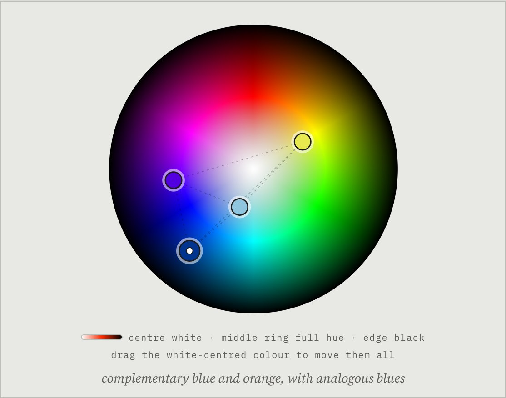
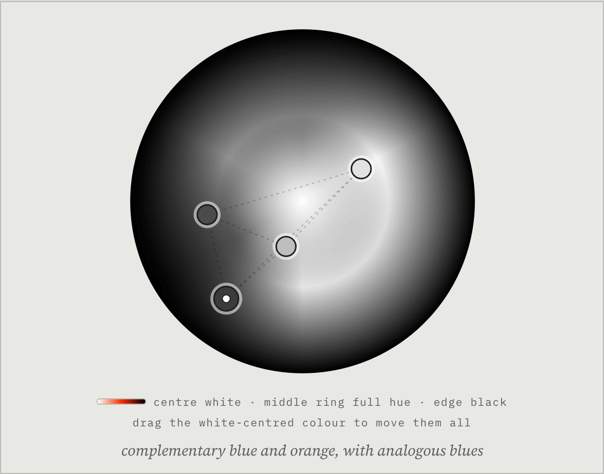

# Palette Builder

**Planning a colour palette in conversation with a language model**
Dan Bartlett · Independent Experimental Research · 2026 · Co-Creation Artifact

<p>
  
  
</p>

*The same palette on the colour disc (left) and in the value view (right). The palette comes from a test against a stand-in server; it was not produced by a model.*

*Palette Builder* is a colour tool for painters and illustrators. You describe the piece you are planning, a language model asks you about it, and only then does it propose a palette. The palette appears on a colour disc that you can rearrange yourself, and the model comments on each change you make.

## Why I made this

Choosing a palette is one of the first decisions in a painting, and one of the most personal. Colour tools usually treat it as geometry: pick a hue, choose a rule such as triadic or split-complementary, and the tool supplies the rest. A painting tutor works differently. They ask what the picture is about, what it is painted with and how it should feel, and their advice follows from the answers. I wanted to see what happens when a language model is asked to work in the second way.

Palette Builder sits between two of the modes of practice in my research. Building it was system co-creation: I wrote the instructions, the disc and the record-keeping, working with Claude as a coding assistant. Using it is artefact co-creation on a small scale, because each palette is made between the artist and the model. Every colour is tagged with who set it, and the page keeps a record of the whole session, so that the two contributions can be looked at afterwards.

## How a palette is made

| | Stage | Who | What happens |
| --- | --- | --- | --- |
| 01 | Gather | Model | One question per turn about the medium, the subject, the format and audience, and the mood. Each answer is filed in the brief above the disc |
| 02 | Propose | Model | Three to six colours, each with a name taken from the subject and a job in the painting, and the harmony in plain words |
| 03 | Rearrange | Artist | Drag any colour to a new hue or lightness, add one or remove one. Dragging the base colour (the one with a white centre) moves the whole palette |
| 04 | Comment | Model | Told what moved and from where, the model says what the change does to temperature, value and harmony |

Two things are done by the page and are not left to the model:

- **A palette is held back until the medium, subject and mood are recorded.** If the model proposes colours earlier, the page says so in the conversation and keeps showing the brief.
- **Every colour is tagged with who set it**: `MODEL`, `MOVED BY YOU` or `ADDED BY YOU`. The current palette and its tags go with every message, so the model always works from the palette as it now stands.

Everything else, such as asking one question at a time, keeping a range of lights and darks, and not moving the artist's colours back, depends on the model following its instructions. The session record shows when it does not.

## The colour disc

Hue runs around the disc, with red at the top. Lightness runs along the radius: white at the centre, the full-strength hue on the middle ring and black at the edge. Painters think about value as much as hue, and this layout puts both under one drag.

Saturation follows from position and cannot be set, so the disc cannot show muted colours such as greys and earths exactly. The model is told this and asked to say when it matters. It is the main limit of the current design, and a saturation control is the next thing I intend to add.

**VALUE** shows every colour as the grey of the same lightness (CIE L\*), much as a painter squints to check that the darks and lights are where they should be. Each swatch also gives its L\* value. The page sits on a neutral grey because colours are judged against their surroundings.

## What has been tested

So far this version has only been run against a stand-in server that imitates vLLM's replies with scripted answers, and against a stand-in for Claude's artifact runtime. The tests cover the conversation, the hold on early palettes, dragging, adding and removing colours, the value view and every saved file, at desktop and phone widths and in light and dark. No session with a real model has been recorded yet, so there are no findings to report. The poster sets out what the first sessions are meant to find out.

## Running it

`index.html` is the whole tool, in one file. It works in two places, and the notebook adds a third.

### Inside Claude

Published as a Claude artifact, the page asks Claude for each reply, using the viewer's own Claude account. Nothing needs installing. The first message asks permission to use Claude. **SAVE** goes through Claude's own download prompt.

### On your own machine, with a local model

Opened as a file on your computer, the page talks to a model server instead. By default it expects **Qwen3.8-27B-FP8** ([model card](https://huggingface.co/Qwen/Qwen3.8-27B-FP8)), served through vLLM, which is the same default as Sketch Lab.

1. **Start the model server** on a machine with a suitable GPU:
   ```bash
   pip install -U vllm
   vllm serve Qwen/Qwen3.8-27B-FP8 --max-model-len 32768
   ```
   The first start downloads the model weights. The server listens on port 8000.
2. **Open the page.** Download `index.html` and double-click it.
3. **Check the connection.** Open **MODEL**, check the server address, and press **TEST**. It should report that the model is loaded.
4. **Start talking.** Describe the piece you are planning and press **SEND**.

Notes:

- **Another machine on your network:** start the server with `--host 0.0.0.0` and set SERVER to that machine's address, for example `http://zgx-nano.local:8000/v1`.
- **Other servers and models:** any OpenAI-compatible server should work, including SGLang and Ollama (`http://localhost:11434/v1`). Change MODEL to the name the server reports. A model does not need to see images for this tool.
- **Thinking** is off by default. Qwen3.8 reasons before answering unless told not to, which mostly adds time here. Switch it on under MODEL to compare.
- **API key:** only needed if the server was started with one. Like the other settings, it is stored only in that browser.
- **Use the downloaded file, not a web link.** A page served from a website can't always reach a server on your own machine. If the browser reports the connection as blocked, check the server's CORS setting (vLLM's `--allowed-origins`).

### In a Jupyter notebook

`notebook/palette-builder.ipynb` runs the same conversation in Python, with the same instructions and the same saved files. It can talk to a local server or to a model on **Hugging Face Inference Providers**; Cell 3 signs in to Hugging Face. Qwen3.8-27B-FP8 is not offered by any provider at the time of writing, so the Hugging Face route uses a different model, set in Cell 4. The notebook has no disc to drag; colours are moved with sliders instead. It also adds `run_script`, which plays a list of artist answers without typing, and `one_line`, which asks for a palette in a single message, for comparing the two.

`notebook/palette-builder.md` is the same notebook as text, kept in step with [Jupytext](https://jupytext.readthedocs.io/).

### Controls

- **SEND** (or Enter): sends your message. Shift+Enter starts a new line. **STOP** or Esc stops a reply.
- **Suggestions:** the short answers under the model's question can be clicked instead of typed.
- **The disc:** drag a colour to change its hue and lightness. Each colour can also be focused with Tab and moved with the arrow keys.
- **+ COLOUR:** adds a colour in the widest gap between the existing hues, and asks the model what it could do. **×** on a swatch removes it; removals are recorded but not sent for comment.
- **VALUE:** switches the disc and swatches to greys of equal lightness.
- **COPY CSS:** copies the palette as CSS custom properties. **HEX** and **RGB** on each swatch copy one colour.
- **SAVE:**
  - **PALETTE · JSON:** the colours, with names, roles, codes, value and who set each one.
  - **SWATCH CARD · SVG:** a printable card of the palette, with a value strip beside each colour.
  - **SESSION RECORD · JSON:** the whole conversation, every palette proposed or held back, and every change on the disc, in order and with times.
- **NEW SESSION:** clears everything after a second press. A session otherwise survives a reload in the same browser.

## In this repository

| Path | What it is |
| --- | --- |
| `index.html` | The tool, as a single self-contained file with its fonts embedded |
| `source/palette-builder.html` | The editable source of the tool. Run `python3 source/build.py` from the repository root to rebuild `index.html` |
| `source/v3.0/` | The previous React version, which ran only inside Claude |
| `notebook/` | The Jupyter notebook version, as `.ipynb` and as Jupytext Markdown |
| `poster/` | The poster, as an A3 PDF and its editable HTML source |
| `docs/images/` | Interface images used here and on the poster |

## Version history

- **v4.0:** rebuilt as a single HTML file that runs inside Claude or against a local model server (Qwen3.8-27B-FP8 by default). The page now holds back early palettes, tags each colour with who set it and keeps a session record. Dragging the base colour moves the whole palette again, colours can be moved from the keyboard, and the value view, saving and a rewritten notebook were added.
- **v3.0:** a neutral grey interface and a disc in hue and lightness, with up to eight colours. A Jupyter notebook version and the first poster.
- **v2.0:** the conversation gathers the medium, subject, format and mood before proposing colours, and the model comments when a colour is dragged on a hue wheel.
- **v1.0:** a description in and a palette out on a hue wheel, with one follow-up question at a time to refine it.

The poster describes v4.0.

## Credits

Written in plain JavaScript and HTML Canvas, with no libraries. The tool uses IBM Plex Mono and Source Serif 4, and the poster uses Gelasio and Courier Prime, all under the SIL Open Font Licence. Developed with coding assistance from Claude.

References: Albers, J. (1963) *Interaction of Color*. Yale University Press. Itten, J. (1961) *The Art of Color*. Reinhold. Joblove, G. H. and Greenberg, D. (1978) 'Color spaces for computer graphics', *SIGGRAPH '78*, pp. 20–25.

Companion pieces: [Sketch Lab](https://github.com/Barto86/sketch-lab), [Dot-Matrix Mind](https://github.com/Barto86/dot-matrix-mind) and [Ninety-Two Layers](https://github.com/Barto86/ninety-two-layers).

© 2026 Dan Bartlett. All rights reserved for the text, images and design. Third-party fonts and models remain under their own licences.
